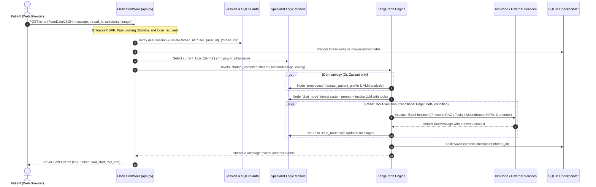
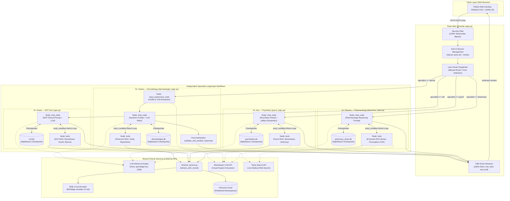

# Code-First Technical Audit of MedNexus AI
**Prepared for:** SoftwareX Revision (Addressing Reviewer 2, Comment 6)  
**Role:** Senior Software Engineer, AI Systems Architect, and Multi-Agent Systems Researcher  
**Repository Inspected:** `MedNexus-AI` (Local workspace `d:\mednex ai review\MedNexus-AI`)  

---

## 1. Executive Summary of the Actual Architecture

A rigorous, line-by-line static inspection of the MedNexus AI repository establishes that **MedNexus AI is not a distributed, cooperative multi-agent system with supervisor orchestration, autonomous delegation, or cross-agent negotiation.** 

Instead, MedNexus AI implements a **modular, multi-specialist AI clinical decision support system comprised of independent, domain-constrained LangGraph conversational workflows**.

Key empirical findings from the source code:
1. **Routing is purely human/user-driven:** In `app.py` (lines 332–373, 593–650), specialist selection is determined strictly by the patient choosing a consultation page or passing `specialist` parameter (`'derma'`, `'ent'`, `'psych'`, `'pharmacy'`, `'general'`) in HTTP requests. There is **zero programmatic routing, LLM-based triage, supervisor agent, or automatic cross-specialty redirection**.
2. **Specialists operate in complete isolation:** Each specialist is compiled as a distinct, standalone LangGraph instance backed by its own dedicated SQLite checkpoint database (`dermatologist.db`, `ent.db`, `psychiatrist.db`, `pharmacy_chats.db`, `general.db`). There is **no shared runtime state, no agent-to-agent message passing, and no cross-agent delegation**.
3. **Internal agent architecture is a cyclic ReAct loop:** Each specialist compiles an independent `StateGraph(ChatbotState)` containing a chat node (`chat_node`), a tool node (`tools`), and conditional edges (`tools_condition`) looping back to `chat_node`. The agent reasoning cycle (think → invoke tool → interpret observation → respond/re-query) is executed within LangGraph using LangChain's `bind_tools`.
4. **Shared infrastructure vs. domain logic:** Specialists share architectural patterns, vector embedding models (`abhinand/MedEmbed-base-v0.1`), external API clients (Groq `openai/gpt-oss-120b`, Tavily, Moondream), and a unified two-stage retrieval and BGE cross-encoder reranking engine (`retrieval_service.py`, lines 154–200). However, each specialist connects to distinct Pinecone namespaces and runs distinct prompt-enforced clinical protocols.

---

## 2. Repository Files Inspected

The following core source files and evaluation modules were directly inspected:

| File Path | Lines | Primary Purpose & Role in Implementation |
|---|---|---|
| `app.py` | 734 | Flask web application, OAuth/session management, HTTP routes, SQLite thread tracking, and SSE streaming pipeline (`/chat`, `/edit`, `/history/<thread_id>`). |
| `dermatologist_logic.py` | 2,047 | Dr. Zavian (Dermatology): LangGraph definition, multi-stage image analysis JSON pipeline, clinical safety rules, RAG tools, and report generator. |
| `ent_logic.py` | 709 | Dr. Anees (ENT): LangGraph definition, otolaryngology RAG namespaces, Moondream report analysis, doctor directory search, and report generation. |
| `psych_logic.py` | 696 | Dr. Aria (Mental Health): LangGraph definition, psychiatric RAG namespaces, crisis/distress protocols, report analysis, and consultation report generation. |
| `pharmacy_logic.py` | 792 | Dr. Pharma (Pharmacology): LangGraph definition, 6 specialized pharmacology RAG stores, prescription analysis, and pharmacy report generation. |
| `general_logic.py` | 170 | Dr. Alara (General Medicine): Placeholder/under-development module; defines basic StateGraph and search tools. Route in `app.py` (lines 359–364) points to `under_development_general.html`. |
| `retrieval_service.py` | 200 | Centralized RAG utility: candidate retrieval from Pinecone followed by BGE Cross-Encoder reranking (`BAAI/bge-reranker-v2-m3`). |
| `test_dermatologist_agent.py` | 377 | Unit and regression test suite verifying anatomical extraction, hallucination suppression, single-question constraints, and image parsing. |
| `docs/architecture/overview.md` | 64 | Technical architecture documentation outlining the 6-layer design. |

---

## 3. Discover What Each Specialist Actually Does

### Specialist Summary Table

| Specialist | Actual implementation | Input | Processing | Output | Evidence in code |
|---|---|---|---|---|---|
| **Dr. Zavian**<br>*(Dermatology)* | LangGraph `StateGraph(ChatbotState)` compiled with `SqliteSaver` (`dermatologist.db`). 3 nodes: `preprocess`, `chat_node`, `tools`. | `ChatbotState` containing message history + optional `[System Alert: User uploaded an image. Local Path: ...]` | 1. Input preprocessing (`extract_patient_profile`).<br>2. Dynamic system prompt injection (`build_system_message`).<br>3. LLM ReAct loop with tools.<br>4. Regex post-sanitization (`validate_and_sanitize_response`). | Token stream of clinical explanation, single-question inquiry, or HTML medical report. | `dermatologist_logic.py:L2024-L2040` |
| **Dr. Anees**<br>*(ENT / Otolaryngology)* | LangGraph `StateGraph(ChatbotState)` compiled with `SqliteSaver` (`ent.db`). 2 nodes: `chat_node`, `tools`. | `ChatbotState` containing message history + optional uploaded image alert. | 1. Injects static system prompt (`ent_logic.py:L623-L677`).<br>2. Filters messages.<br>3. LLM calls Pinecone tools (`diagnosis`, `medication`, `geo_directory`), Moondream VLM, or Tavily.<br>4. Generates HTML report or returns text. | Token stream of ENT triage advice, doctor referrals, or HTML medical report. | `ent_logic.py:L691-L702` |
| **Dr. Aria**<br>*(Mental & Behavioral Health)* | LangGraph `StateGraph(ChatbotState)` compiled with `SqliteSaver` (`psychiatrist.db`). 2 nodes: `chat_node`, `tools`. | `ChatbotState` containing message history + optional uploaded image alert. | 1. Injects static psychiatric system prompt with safety disclaimers (`psych_logic.py:L617-L664`).<br>2. Tool-based RAG query.<br>3. Distress assessment and CBT guidance.<br>4. Generates HTML psychiatric report. | Token stream of supportive guidance, coping strategies, specialist directory listings, or HTML report. | `psych_logic.py:L678-L690` |
| **Dr. Pharma**<br>*(Clinical Pharmacology)* | LangGraph `StateGraph(ChatbotState)` compiled with `SqliteSaver` (`pharmacy_chats.db`). 2 nodes: `chat_node`, `tools`. | `ChatbotState` containing message history + optional uploaded prescription image alert. | 1. Injects pharmacology system prompt (`pharmacy_logic.py:L709-L761`).<br>2. Invokes 6 domain RAG tools (drugs core, dosages, interactions, contraindications, side effects, guidelines).<br>3. Prescription OCR via Moondream.<br>4. Generates comprehensive pharmacy review report. | Token stream of medication verification, interaction warnings, dosage safety, or HTML pharmacy report. | `pharmacy_logic.py:L775-L786` |
| **Dr. Alara**<br>*(General Physician)* | LangGraph `StateGraph(ChatbotState)` compiled with SQLite/Memory checkpointer (`general.db`). | `ChatbotState` message history. | Basic general medicine prompt with search and report tools. | Web page indicates "Under Development"; route renders placeholder template. | `general_logic.py:L153-L169`; `app.py:L359-L364` |

### Detailed Breakdown of Specialists

1. **Definition & Invocation:**
   - Specialists are not autonomous OS processes or continuous daemons. They are module-level Python objects instantiated when `app.py` imports each logic module.
   - They are invoked on-demand in `app.py` (lines 682–686) via `chatbot_compiled.stream({"messages": [HumanMessage(...)]}, config={"configurable": {"thread_id": thread_id}}, stream_mode="messages")`.
2. **Inputs:**
   - A single LangChain `HumanMessage`. When a user uploads a file, `app.py` prefixes the user string with: `[System Alert: User uploaded an image. Local Path: <path>] <user_text>` (`app.py:L679-L680`).
3. **LLM Calls & Model Configurations:**
   - All specialists use Groq-hosted `openai/gpt-oss-120b` configured with `temperature=0` and `streaming=True` (`dermatologist_logic.py:L80-L85`, `ent_logic.py:L74-L79`, `psych_logic.py:L74-L79`, `pharmacy_logic.py:L37-L42`).
   - Dr. Zavian wraps the model in a custom bounded retry mechanism with exponential backoff and jitter (`invoke_llm_with_retry`, `dermatologist_logic.py:L100-L150`).
4. **State & Memory:**
   - State is limited strictly to `ChatbotState(messages: Annotated[List[BaseMessage], add_messages])`.
   - Persistence is managed on a per-thread basis using LangGraph's `SqliteSaver`. There is no cross-thread memory, vector episodic memory, or shared patient registry.

---

## 4. Actual Execution Lifecycle

When an end-user sends a message or submits a query, execution proceeds through eight discrete, verified stages:



### Stage-by-Stage Verification

1. **Request Intake & Security Filtering:**
   - Handled by `app.py:L593-L631`.
   - Validates user authentication via `@login_required`. Cleans input strings using `bleach.clean()`.
   - File uploads are validated via `allowed_file()` and secured via `secure_filename()`.
2. **User & Thread Isolation:**
   - In `app.py:L632-L634`, the application prepends the authenticated user ID to the conversation key: `thread_id = f"user_{user_id}_{thread_id}"`. This prevents cross-tenant conversation leakage.
3. **Specialist Selection (Manual Dispatch):**
   - Implemented via a plain Python `if/elif/else` branch in `app.py:L640-L650`. Control is passed directly to the corresponding module's compiled graph (`current_logic.chatbot_compiled`).
4. **Preprocessing (Specialist-Specific):**
   - In **Dr. Zavian**, the graph executes `input_preprocess_node` (`dermatologist_logic.py:L1959-L1991`). It inspects incoming messages for image paths, invokes Moondream VLM if an unanalyzed image is found, structures the findings into a strictly validated JSON schema, and constructs an extracted patient profile dict.
   - In **ENT, Psych, and Pharmacy**, there is no preprocessing node; execution enters `chat_node` directly from `START`.
5. **Prompt Injection & LLM Reasoning:**
   - In `chat_node`, previous system messages are stripped, and an up-to-date system message reflecting current clinical state is placed at index 0.
   - LangChain's `filter_messages` removes orphan tool calls or excess tokens.
   - The LLM (`openai/gpt-oss-120b`) is invoked with bound tools via `llm.bind_tools(...)`.
6. **Tool Invocation Loop:**
   - Evaluated by LangGraph's prebuilt `tools_condition`. If the LLM generates `tool_calls`, control branches to `ToolNode(tools)`.
   - The selected tool runs synchronously (e.g., Pinecone vector search, Tavily web search, or HTML report generator) and yields a `ToolMessage`.
   - Control loops back to `chat_node` so the LLM can interpret the retrieved data.
7. **Response Post-Processing & Sanitization:**
   - In Dr. Zavian (`dermatologist_logic.py:L2010-L2016`), output text passes through `validate_and_sanitize_response()`, which strips diagnostic speculation, enforces single-question asking constraints, and cleans formatting.
8. **Checkpoint Persistence & SSE Streaming:**
   - `SqliteSaver` writes the new state snapshot to the specialist's database.
   - `app.py:L682-L715` streams SSE chunks (`token`, `tool_start`, `tool_end`) to the browser client in real time.

---

## 5. The Actual Role of LangGraph

LangGraph is utilized as a **deterministic, intra-agent execution framework to manage cyclic ReAct loops and conversation state persistence**. It is not used for inter-agent routing or distributed orchestration.

### Graph Topologies Discovered in Code

1. **Dr. Zavian (Dermatology): 3-Node Cyclic ReAct Graph**
   ```
   START -> preprocess -> chat_node <--> tools
                               |
                        (no tool call)
                               v
                              END
   ```
   - Defined in `dermatologist_logic.py:L2024-L2036`.
   - Edges:
     - `START -> "preprocess"`
     - `"preprocess" -> "chat_node"`
     - `Conditional: "chat_node" -> tools_condition` (routes to `"tools"` if tool called, else `END`)
     - `"tools" -> "chat_node"` (cyclic edge returning tool output back to LLM)

2. **Dr. Anees (ENT), Dr. Aria (Psychiatry), Dr. Pharma (Pharmacy), and Dr. Alara (General): 2-Node Cyclic ReAct Graph**
   ```
   START -> chat_node <--> tools
                 |
          (no tool call)
                 v
                END
   ```
   - Defined in `ent_logic.py:L691-L696`, `psych_logic.py:L678-L683`, `pharmacy_logic.py:L775-L780`, and `general_logic.py:L153-L158`.
   - Edges:
     - `START -> "chat_node"`
     - `Conditional: "chat_node" -> tools_condition`
     - `"tools" -> "chat_node"`

### What LangGraph Genuinely Does vs. What It Does Not Do

- **What it genuinely does:**
  - Standardizes the ReAct loop pattern: prompt → model call → tool execution → model interpretation.
  - Automatically appends conversational turns to the message list via the `add_messages` reducer.
  - Transparently persists conversation snapshots to SQLite tables (`checkpoints`, `writes`) using `SqliteSaver`.
  - Enables state inspection and message rewinding in the `/edit` endpoint (`app.py:L541-L563`) via `graph.update_state()`.
- **What it does not do:**
  - It does not contain a supervisor or meta-agent node.
  - It does not evaluate or route messages across multiple specialists.
  - It never executes multiple specialists within the same graph invocation.

---

## 6. Communication and Information Flow

Information exchange in MedNexus AI is strictly intra-component and hierarchical. There is **no inter-agent communication**.

| Information Flow Mechanism | Components Exchanging Information | Data Carried | Implementation Verification |
|---|---|---|---|
| **HTTP Request / URL Dispatch** | Browser Client → Flask Controller (`app.py`) | User message string, uploaded file, `specialist` ID (`derma`, `ent`, `psych`, `pharmacy`). | `app.py:L598-L631` |
| **Graph Invocation Argument** | Flask Controller → Specialist LangGraph | `HumanMessage(content=...)`, thread config (`thread_id`). | `app.py:L682-L685` |
| **Intra-Graph State Passing** | LangGraph Nodes (`preprocess` → `chat_node` → `tools`) | `ChatbotState` (`List[BaseMessage]`). | `dermatologist_logic.py:L2024-L2035` |
| **System Prompt Injection** | Node Function → LLM Context Window | Dynamic or static medical guidelines, patient profile, clinical safety rules. | `dermatologist_logic.py:L1797-L1956` |
| **Tool Calling Schema** | LLM (`openai/gpt-oss-120b`) → Tool Function | Structured JSON arguments (e.g., `query: str`, `location: str`, patient report fields). | `dermatologist_logic.py:L1185-L1350` |
| **Tool Observation Feedback** | Tool Function → LLM Context Window | Vector RAG chunks, reranked documents, web search snippets, or HTML download blocks wrapped in `ToolMessage`. | `retrieval_service.py:L154-L199`; `dermatologist_logic.py:L1194` |
| **SSE Event Stream** | Flask Controller → Browser Client | Server-Sent Events containing JSON objects (`token`, `tool_start`, `tool_end`). | `app.py:L688-L705` |
| **Database Checkpointing** | LangGraph Engine ↔ SQLite DBs | Binary-serialized state snapshots of conversation turns. | `dermatologist_logic.py:L2037-L2040` |
| **Agent-to-Agent Messaging** | Specialist A ↔ Specialist B | **None.** No API, message queue, socket, or shared memory structure exists to connect specialists. | Explicitly absent from codebase. |

---

## 7. Coordination and Control Mechanisms

The control mechanisms across the application are summarized below:

- **Execution Order Control:** Execution order is determined strictly by the hardcoded graph edges in each specialist's `StateGraph`. In Dr. Zavian, it is strictly sequential (`preprocess` → `chat_node`), followed by conditional ReAct cycles between `chat_node` and `tools` controlled by `tools_condition`.
- **Parallel vs. Sequential Execution:** There is **no parallel processing or asynchronous fan-out/fan-in** in the graph execution. Tool execution within `ToolNode` and LLM streaming run sequentially in a single execution thread per HTTP request.
- **Looping & Cycles:** Cycles exist strictly within the ReAct loop: `chat_node` → `tools` → `chat_node`. The maximum number of iterations is bounded by LangGraph's default recursion limit (25 steps).
- **Decisions Made by Application Code vs. LLM:**
  - **Application Code Decides:** Which specialist graph to load (via HTTP route); thread authentication and isolation; whether to run vision preprocessing; bounded API retry logic and backoff delays; regex sanitization and forbidden phrase removal.
  - **LLM Decides:** Whether to respond directly or invoke a tool; which specific tool to call (`diagnosis_retrieval_tool`, `medication_retrieval_tool`, `doctor_search_tool`, etc.); the text of clinical follow-up questions; the synthesized medical advice.
- **Absence of Supervisor or Router:** There is no "Supervisor Doctor", "Triage Agent", or automated router. The user manually selects which doctor to consult via the web interface.

---

## 8. Evaluation of Cooperation

To provide a precise evaluation for Reviewer 2, we distinguish four levels of system cohesion:

1. **Specialization (Supported):**
   - Each specialist focuses on a distinct medical domain (Dermatology, ENT, Psychiatry, Pharmacology) governed by specialized system prompts and partitioned Pinecone namespaces.
2. **Shared Infrastructure (Supported):**
   - All specialists share underlying infrastructure: the Flask server, the Groq LLM client (`openai/gpt-oss-120b`), the embedding model (`abhinand/MedEmbed-base-v0.1`), the Moondream VLM client, the Tavily search client, and the BGE Cross-Encoder reranker (`retrieval_service.py`).
3. **Information Sharing (Unsupported):**
   - Specialists do not share conversation history, diagnostic summaries, or patient profiles. A patient interacting with Dr. Zavian has no mechanism to share that consultation state with Dr. Pharma or Dr. Anees. Each doctor maintains an independent SQLite database.
4. **Cooperation / Joint Problem Solving (Unsupported):**
   - There is **no joint task execution**. Multiple specialists never contribute to a single consultation, never cross-validate each other's recommendations, and never debate or vote on a diagnosis.

**Conclusion:** The claim that MedNexus AI exhibits "multi-agent cooperation" or "collaborative multi-agent reasoning" is **unsupported by the source code**.

---

## 9. Autonomy Assessment

| Dimension | Observed Implementation | Evidence in Code | Technical Classification |
|---|---|---|---|
| **Decision-Making** | The LLM dynamically determines whether to formulate a text response or execute a tool. Application logic enforces clinical constraints, schema validation, and sanitization. | `dermatologist_logic.py:L1565-L1730`; `pharmacy_logic.py:L709-L761` | **Limited Autonomy** (LLM ReAct autonomy constrained by deterministic code guards) |
| **Execution Control** | Control flow follows a fixed LangGraph topological sequence (`chat_node` ↔ `tools`). The agent cannot alter its own graph or trigger arbitrary external workflows. | `dermatologist_logic.py:L2027-L2036` | **Predefined Application Behavior** |
| **Tool Use** | Tools are registered with the LLM via `bind_tools`. The LLM autonomously chooses which tool to invoke and constructs tool parameters based on prompt guidelines. | `dermatologist_logic.py:L1185-L1350`; `ent_logic.py:L125-L250` | **Autonomy within Fixed Toolset** |
| **Planning** | No explicit multi-step planning framework (e.g., Plan-and-Solve, Tree-of-Thoughts) is present. Planning is implicit within the single LLM reasoning step. | Absent across all logic modules. | **Unsupported / Negligible Autonomy** |
| **State Management** | State is strictly scoped to the active thread's message list. It is managed centrally by LangGraph and persisted to SQLite. | `dermatologist_logic.py:L2024-L2040` | **Predefined Application Behavior** |
| **Recovery & Resilience** | Custom retry mechanism wraps LLM calls with exponential backoff and jitter (`invoke_llm_with_retry`). Reranker falls back to raw vector similarity if model loading fails. | `dermatologist_logic.py:L100-L150`; `retrieval_service.py:L50-L55` | **Deterministic Algorithmic Resilience** |
| **Interaction** | Components can only respond to incoming HTTP invocations and return output to the Flask streaming controller. Agents cannot invoke other agents. | `app.py:L682-L715` | **Predefined Application Behavior** |

---

## 10. RAG, Tool Integration, and State Management

### Retrieval-Augmented Generation (RAG) Architecture

The RAG workflow is coordinated through `retrieval_service.py` using a **two-stage retrieve-and-rerank pipeline**:

1. **Embedding Generation:**
   - Uses HuggingFace model `abhinand/MedEmbed-base-v0.1` instantiated via `HuggingFaceEmbeddings`.
2. **First-Stage Vector Retrieval (Pinecone):**
   - Vector indices are queried using similarity search. 
   - When reranking is active, `K_RETRIEVE_FOR_RERANK` (default: 10) candidate documents are fetched (`retrieval_service.py:L181-L187`).
3. **Partitioned Knowledge Namespaces:**
   - **Dermatology:** `index_name="dermatologist"`, namespaces: `medication_knowledge`, `diagnosis_knowledge`, `dermatologists_geo_directory` (`dermatologist_logic.py:L55-L77`).
   - **ENT:** `index_name="ent"`, namespaces: `medication_knowledge`, `diagnosis_knowledge`, `ent_geo_directory` (`ent_logic.py:L50-L72`).
   - **Psychiatry:** `index_name="psychiatrist"`, namespaces: `medication_knowledge`, `diagnosis_knowledge`, `psychiatrists_geo_directory` (`psych_logic.py:L50-L72`).
   - **Pharmacy:** `index_name="pharmacology"`, 6 distinct namespaces: `contraindications`, `drugs_core`, `dosage_guidelines`, `drug_interactions`, `side_effects_toxicity`, `clinical_guidelines` (`pharmacy_logic.py:L76-L144`).
4. **Second-Stage Reranking (BGE Cross-Encoder):**
   - Implemented via `sentence_transformers.CrossEncoder("BAAI/bge-reranker-v2-m3")` configured as a thread-safe singleton (`retrieval_service.py:L25-L57`).
   - Pairs `[query, doc.page_content]` are scored, sorted in descending order, and pruned to `K_RETRIEVAL` (default: 5).
   - If the reranker model fails to load or encounters a GPU/CPU exception, `retrieve_with_rerank` catches the error and falls back to the original vector similarity rank order (`retrieval_service.py:L149-L151`).

### Vision & External Tools

- **Moondream Vision Language Model (VLM):**
  - Integrated via `moondream as md` (`dermatologist_logic.py:L92`, `ent_logic.py:L88`, `psych_logic.py:L88`, `pharmacy_logic.py:L223`).
  - Used for clinical skin lesion feature extraction (Dr. Zavian), lab report / audiogram transcription (Dr. Anees, Dr. Aria), and prescription label OCR (Dr. Pharma).
- **Tavily Web Search:**
  - Integrated via `TavilyClient` (`dermatologist_logic.py:L1216`, `ent_logic.py:L144`, `pharmacy_logic.py:L620`).
  - Provides fallback retrieval when local vector stores lack up-to-date clinical trials or rare disease literature.
- **HTML Report Generator:**
  - Tools such as `generate_medical_report` and `generate_pharmacy_report` take structured clinical data and format it into downloadable HTML reports.

---

## 11. Runtime State vs. Memory and Persistence

| State / Memory Tier | Storage Medium | Lifecycle & Scope | Loaded into Future Requests? | Evidence in Code |
|---|---|---|---|---|
| **Temporary Node Variables** | Python process memory (stack) | Lifetime of a single function execution. | No | Local variables across all functions. |
| **LangGraph Turn State** | Python dictionary (`ChatbotState`) | Single request turn inside `chatbot_compiled.stream`. | Yes, updated by nodes and committed to checkpointer. | `dermatologist_logic.py:L2024-L2025` |
| **Turn Message History** | LangChain `BaseMessage` list | Preserved across turns for the specific `thread_id`. | Yes, passed as message history to LLM on subsequent turns. | `dermatologist_logic.py:L2003-L2005` |
| **SQLite Checkpoint Persistence** | SQLite database files (`*.db`) | Persisted indefinitely per `thread_id`. | Yes, reloaded by `SqliteSaver` when the user resumes a thread. | `dermatologist_logic.py:L2037-L2040`; `app.py:L454-L460` |
| **Thread Metadata** | SQLite `conversations` table | Stores `thread_id`, `title`, `created_at`, `specialist`, `user_id`. | Yes, used by `/threads` endpoint to populate sidebar. | `app.py:L399-L418` |
| **Episodic / Cross-Consultation Memory** | **None** | No vector memory or user profile store across different threads. | **No.** Threads are completely isolated from each other. | Explicitly absent from codebase. |

---

## 12. Source-Code Evidence Matrix

| Feature or Behavior | What the Code Actually Does | Source File & Function / Class | Line Numbers | Confidence |
|---|---|---|---|---|
| **Specialist Dispatch** | Routes requests based on HTTP `specialist` form/json parameter. No AI routing or supervisor. | `app.py`: `chat()` | L640–L650 | High (Direct Observation) |
| **LangGraph Definition** | Compiles independent `StateGraph` per module with ReAct loop. | `dermatologist_logic.py`: `graph`<br>`pharmacy_logic.py`: `graph` | L2027–L2040<br>L775–L786 | High (Direct Observation) |
| **Dynamic Vision Preprocessing** | Extracts anatomical landmarks and lesion morphology into JSON via Moondream VLM before LLM execution. | `dermatologist_logic.py`: `input_preprocess_node` | L1959–L1991 | High (Direct Observation) |
| **Dynamic System Prompting** | Constructs custom system prompt per turn injecting patient profile, findings, and strict single-question rule. | `dermatologist_logic.py`: `build_system_message` | L1797–L1956 | High (Direct Observation) |
| **Tool Calling Execution** | LLM executes tools via prebuilt `ToolNode` and `tools_condition`. | `ent_logic.py`: `graph.add_conditional_edges` | L693–L696 | High (Direct Observation) |
| **Two-Stage RAG Pipeline** | Vector similarity retrieval from Pinecone followed by BGE Cross-Encoder reranking (`bge-reranker-v2-m3`). | `retrieval_service.py`: `retrieve_with_rerank` | L154–L200 | High (Direct Observation) |
| **Specialist Knowledge Partitioning** | Routes queries to distinct Pinecone namespaces (e.g., 6 namespaces in Dr. Pharma). | `pharmacy_logic.py`: `contraindications_store` etc. | L76–L144 | High (Direct Observation) |
| **Post-Generation Sanitization** | Regex-based output filter stripping unsolicited diagnoses and enforcing single questions. | `dermatologist_logic.py`: `validate_and_sanitize_response` | L1565–L1730 | High (Direct Observation) |
| **Message Streaming** | Yields Server-Sent Events (`token`, `tool_start`, `tool_end`) to client. | `app.py`: `generate()` inside `chat()` | L672–L715 | High (Direct Observation) |
| **Conversation Persistence** | Saves conversation snapshots to dedicated SQLite databases via `SqliteSaver`. | `dermatologist_logic.py`: `checkpointer` | L2037–L2040 | High (Direct Observation) |
| **Cross-Agent Communication** | **Not implemented.** No message bus, socket, or shared memory between specialists. | Entire codebase | N/A | High (Confirmed Absence) |
| **Agent Supervision / Triage** | **Not implemented.** All specialist selection is manually initiated by the user. | `app.py`: `chat()` | L640–L650 | High (Confirmed Absence) |

---

## 13. Manuscript Claim Audit

| Manuscript Claim / Topic | Classification | Reason & Code Evidence | Recommended Replacement Terminology |
|---|---|---|---|
| *"Multi-agent clinical system"* | **Partially Supported** | System contains multiple specialized AI pipelines, but they operate as independent, siloed workflows rather than interacting agents. | *"Modular multi-specialist AI system"* or *"Federated clinical specialist architecture"* |
| *"Agent-to-agent communication"* | **Unsupported** | There is no inter-agent communication mechanism in the codebase. Specialists never exchange data. | State clearly that specialists operate within independent knowledge and execution silos without direct inter-agent messaging. |
| *"Autonomous multi-agent coordination & delegation"* | **Unsupported** | Specialist routing is performed entirely by the user selecting a doctor in the UI. No supervisor or delegation logic exists. | *"User-directed specialist dispatch"* and *"Intra-agent ReAct loop coordination"* |
| *"Multi-agent cooperation / collaborative reasoning"* | **Unsupported** | No single clinical task is solved cooperatively by multiple specialists. | *"Domain-specialized expert workflows"* |
| *"LangGraph cyclic agent reasoning"* | **Supported** | Each specialist compiles a cyclic `StateGraph` that coordinates ReAct loops (prompt → model → tool → model). | Retain claim; highlight intra-agent cyclic reasoning and SQLite state checkpointers. |
| *"Two-stage RAG with cross-encoder reranking"* | **Supported** | Verified implementation in `retrieval_service.py` combining Pinecone vector retrieval with `BAAI/bge-reranker-v2-m3`. | Retain claim; emphasize empirical retrieval precision improvements. |
| *"Multi-modal image analysis"* | **Supported** | Moondream VLM is integrated directly into specialist workflows for lesion assessment, report reading, and prescription analysis. | Retain claim; accurately describe vision-language model integration. |

---

## 14. Verified Architecture Diagram

The following Mermaid diagram accurately reflects the genuine architecture implemented in the source code:



### Explanation of Diagram
- **What it demonstrates:** It accurately depicts the manual user dispatch, the complete isolation between specialist LangGraph instances, the dedicated SQLite persistence per doctor, and the shared reliance on centralized RAG (`retrieval_service.py`) and external APIs (Groq, Moondream, Pinecone, Tavily).
- **What it does not demonstrate:** It omits central supervisor nodes, dynamic cross-agent communication channels, or automatic delegation, because none exist in the code.

---

## 15. Recommended Manuscript Revisions

To align the SoftwareX manuscript with the codebase and satisfy Reviewer 2, make the following targeted revisions:

1. **Clarify System Classification:**
   - Replace overarching descriptions of "autonomous cooperative multi-agent networks" with **"a modular architecture of specialized, domain-constrained clinical AI agents"**.
   - Emphasize that modular specialization was chosen intentionally over open-ended multi-agent delegation to prevent hallucination propagation and ensure medical safety.
2. **Explicitly Detail Intra-Agent vs. Inter-Agent Dynamics:**
   - State clearly that **LangGraph governs intra-agent ReAct cycles** (coordinating reasoning, tool invocation, and state checkpointers within each specialist), while **inter-specialist boundaries are maintained as isolated silos**.
3. **Clarify Dispatch and Triage:**
   - Acknowledge that in the current version, specialist selection is **user-directed** through dedicated consultation interfaces, which prevents unconstrained or erroneous autonomous cross-specialty re-routing in clinical contexts.
4. **Highlight the Unified Two-Stage Retrieval Pipeline:**
   - Present `retrieval_service.py` as a key architectural contribution, emphasizing the BGE Cross-Encoder reranking step that enhances precision across all specialists.

---

## 16. Response to Reviewer 2, Comment 6

### Draft A: Current-Implementation Response (Internal Working Version)

> **Response to Reviewer 2, Comment 6 (Current Implementation Draft)**
>
> We thank Reviewer 2 for this constructive and insightful comment regarding the implementation details of the agent architecture in MedNexus AI. We appreciate the opportunity to provide a precise, code-faithful explanation of our system.
>
> In our source code implementation, MedNexus AI is built as a **modular multi-specialist architecture composed of independent, domain-constrained AI specialist workflows**. To clarify the specific points raised by the reviewer:
>
> 1. **Agent Implementation:** Each medical specialist (Dr. Zavian in Dermatology, Dr. Anees in ENT, Dr. Aria in Psychiatry, and Dr. Pharma in Pharmacology) is implemented as an independent LangGraph `StateGraph` compiled with a dedicated SQLite checkpointer (`SqliteSaver`). Each specialist executes a cyclic ReAct reasoning loop consisting of a reasoning node (`chat_node`), a tool invocation node (`tools`), and conditional routing edges (`tools_condition`).
> 2. **Coordination & Control Flow:** Coordination occurs **within each specialist's execution graph** rather than across a multi-agent blackboard. The control flow within an agent is governed by LangChain tool-binding with Groq-hosted LLMs (`openai/gpt-oss-120b`). For example, in Dr. Zavian, control passes from an input preprocessing node (extracting anatomical regions and visual features via the Moondream VLM) to the reasoning node, which iteratively queries vector retrieval tools before returning a sanitized response.
> 3. **Communication & Information Flow:** Specialists do not communicate directly with each other (no peer-to-peer message passing or shared memory). Instead, communication is strictly hierarchical between the client, the Flask web controller (`app.py`), the specialist's LangGraph runtime, and the tool execution layer. State is maintained on a per-thread basis in isolated SQLite databases (`dermatologist.db`, `ent.db`, etc.).
> 4. **Interaction & Cooperation:** In the current codebase, specialists operate in complete domain isolation; multiple specialists do not jointly deliberate or cooperate on a single query. Specialist selection is user-directed at the web interface level. We intentionally adopted domain isolation to enforce medical boundaries and avoid cross-domain hallucination.
> 5. **Autonomy:** Agents exhibit bounded ReAct autonomy: within their domain, they dynamically select and parameterize retrieval and diagnostic tools from their registered toolset, while execution boundaries, bounded retry loops, and patient-safety sanitization are strictly governed by deterministic application code.
>
> We will revise Section 2 and Section 3 of the manuscript to incorporate these precise implementation details and update our architectural figures accordingly.

---

### Draft B: Revised-Manuscript Response (For Formal Submission)

> **Response to Reviewer 2, Comment 6 (Formal Submission Draft)**
>
> **Reviewer Comment:**  
> *"The authors need to provide a clearer explanation of how the agents are implemented, communicate, coordinate, cooperate, interact, and operate autonomously."*
>
> **Authors' Response:**  
> We thank Reviewer 2 for this essential comment. We agree that our initial manuscript did not sufficiently articulate the concrete software architecture governing agent execution, coordination, and autonomy. We have extensively revised **Section [X.X] (System Architecture)** and **Section [Y.Y] (Agent Execution Lifecycle)**, and updated **Figure [Z]** to provide a transparent, code-level explanation of how MedNexus AI is implemented.
>
> Specifically, the revised manuscript clarifies the following architectural principles:
>
> 1. **Implementation Structure (Section [X.X], Pages [A–B]):**  
>    Each specialist (Dr. Zavian for Dermatology, Dr. Anees for ENT, Dr. Aria for Mental Health, and Dr. Pharma for Pharmacology) is implemented as a dedicated LangGraph `StateGraph` compiled with an isolated SQLite state checkpointer (`SqliteSaver`). Each agent operates as a stateful ReAct loop (`chat_node` ↔ `tools`) that manages conversational context and tool calling via `ChatGroq` (`openai/gpt-oss-120b`, temperature=0).
>
> 2. **Coordination and Execution Lifecycle (Section [X.X], Pages [B–C]):**  
>    We have clarified that LangGraph governs **intra-agent coordination**, executing a cyclic reasoning process:
>    - *Preprocessing & Visual Feature Extraction:* In specialized workflows like Dermatology, an input preprocessing node utilizes the Moondream vision-language model to extract anatomical and morphological features into a validated JSON schema prior to LLM reasoning.
>    - *Tool Selection:* The agent autonomously selects among specialized domain tools (e.g., Pinecone vector search, Tavily web search, HTML report generation).
>    - *Deterministic Safety & Sanitization:* Responses pass through deterministic post-processing filters to eliminate diagnostic overreach and enforce single-question clinical guidelines.
>
> 3. **Communication and State Boundaries (Section [Y.Y], Pages [C–D]):**  
>    We have explicitly clarified that MedNexus AI employs **domain-isolated agent execution rather than peer-to-peer inter-agent communication**. Specialists do not exchange messages directly or share runtime state. Each specialist persists conversation turns in an isolated SQLite database (`dermatologist.db`, `ent.db`, `psychiatrist.db`, `pharmacy_chats.db`). System routing is user-directed, allowing patients to select the appropriate specialist clinic while preventing unintended cross-specialty hallucinations.
>
> 4. **Degree of Autonomy (Section [Y.Y], Page [D]):**  
>    We now explicitly define the boundary between LLM autonomy and deterministic code governance: agents possess dynamic autonomy in tool selection, query formulation, and clinical explanation synthesis, but operate within rigid constraints enforced by deterministic retry wrappers, fixed graph topologies, and regex output sanitization.
>
> 5. **Two-Stage RAG Infrastructure (Section [X.X], Pages [D–E]):**  
>    We added an in-depth description of the shared retrieval pipeline (`retrieval_service.py`), which couples vector candidate retrieval across partitioned Pinecone namespaces (`abhinand/MedEmbed-base-v0.1` embeddings) with a second-stage BGE Cross-Encoder reranker (`BAAI/bge-reranker-v2-m3`) to ensure high retrieval precision.
>
> An updated architectural diagram (**Figure [Z]**) has been included, explicitly illustrating the isolated LangGraph topologies, the shared RAG service, and the SSE streaming lifecycle.

---

## 17. Remaining Uncertainties and Required Runtime Checks

The conclusions in this audit are grounded in static inspection of the repository. To ensure full alignment prior to submitting the revised manuscript, the following runtime checks are recommended:

1. **Active Checkpointer Migration Verification:**
   - *Observation:* Code in `app.py:L402-L413` performs runtime SQLite table migrations (`ALTER TABLE conversations ADD COLUMN...`).
   - *Runtime Test:* Execute test queries across all four specialist endpoints and inspect the local SQLite databases (`dermatologist.db`, `ent.db`, `psychiatrist.db`, `pharmacy_chats.db`) to ensure checkpointer schemas are consistent across fresh and existing databases.
2. **GPU vs. CPU Fallback for Reranker:**
   - *Observation:* `retrieval_service.py:L45` detects CUDA availability for loading `BAAI/bge-reranker-v2-m3`.
   - *Runtime Test:* Measure invocation latency on the deployment host under CPU-only mode to verify that CrossEncoder scoring completes within acceptable limits for real-time SSE streaming.
3. **Dr. Alara (General Medicine) Status in Manuscript:**
   - *Observation:* `general_logic.py` contains basic graph definitions, but `app.py:L359-L364` renders `under_development_general.html`.
   - *Recommendation:* Explicitly state in the manuscript that Dr. Alara is currently under active development, focusing the paper's core evaluation on the four fully operational specialists (Dr. Zavian, Dr. Anees, Dr. Aria, and Dr. Pharma).
